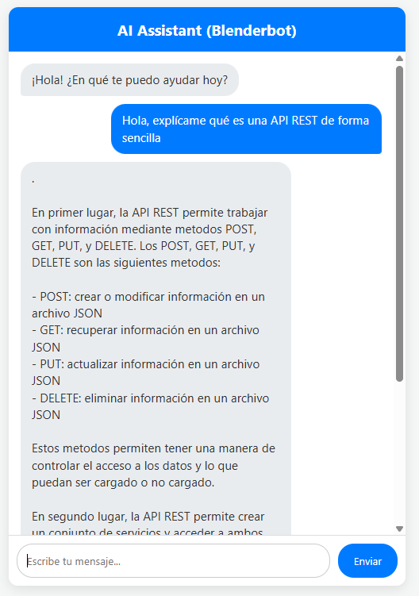

# 🤖 Local AI Chatbot Web App (Flask + SmolLM2)

Aplicación web interactiva que despliega un modelo de lenguaje ligero en local (**SmolLM2-360M-Instruct**) utilizando **Flask** en el backend y una interfaz web moderna en **HTML5, CSS3 y JavaScript**.



## 🚀 Características
- **Inferencia 100% Local:** Integración directa con Hugging Face Transformers sin depender de claves de API externas.
- **Backend Robusto:** Servidor REST con Flask y Flask-CORS optimizado para procesamiento asíncrono.
- **Gestión de Contexto Avanzada:** Formateo de conversaciones mediante `apply_chat_template` e historial estructurado por roles (`system`, `user`, `assistant`).
- **UI Responsiva y Fluida:** Interfaz intuitiva en tiempo real con desplazamiento automático y control de errores (`fetch` asíncrono).
- **Soporte Multilingüe:** Optimizado para comprender e interactuar fluidamente en español.

## 🛠️ Tecnologías Utilizadas
- **Lenguaje:** Python 3.11+
- **Backend:** Flask, Flask-CORS
- **IA / ML:** PyTorch, Transformers, Accelerate
- **Modelo:** `HuggingFaceTB/SmolLM2-360M-Instruct`
- **Frontend:** HTML5, CSS3, JavaScript (ES6 Fetch API)


## 🔧 Instalación y Ejecución Local

### 1. Clonar el repositorio
```bash
git clone [https://github.com/Raul-coder07/flask-chatbot.git](https://github.com/Raul-coder07/flask-chatbot.git)
cd flask-chatbot
```

### 2. Crear y activar el entorno virtual
- **Windows (PowerShell):**
  ```powershell
  python -m venv my_venv
  .\my_venv\Scripts\Activate.ps1
  ```
- **Linux / macOS:**
  ```bash
  python3 -m venv my_venv
  source my_venv/bin/activate
  ```

### 3. Instalar dependencias
```bash
pip install -r requirements.txt
```

### 4. Iniciar la aplicación
```bash
python app.py
```

### 5. Acceder a la interfaz
Abre tu navegador e ingresa a:
`http://127.0.0.1:5000/`
